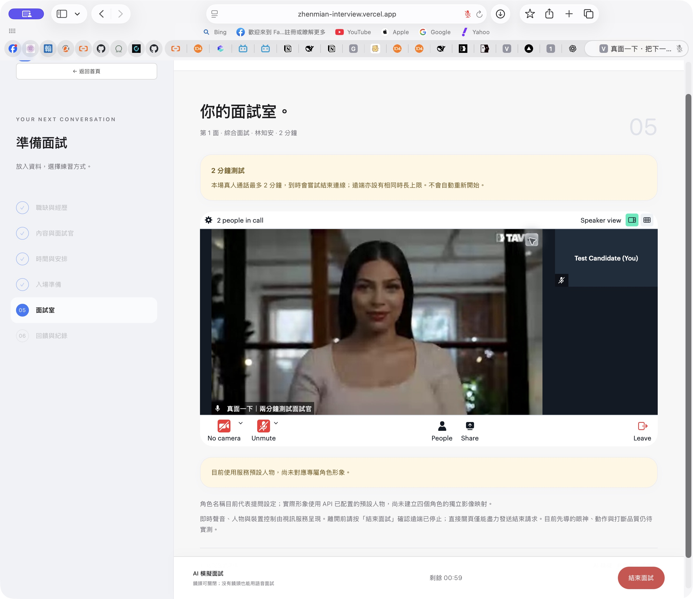
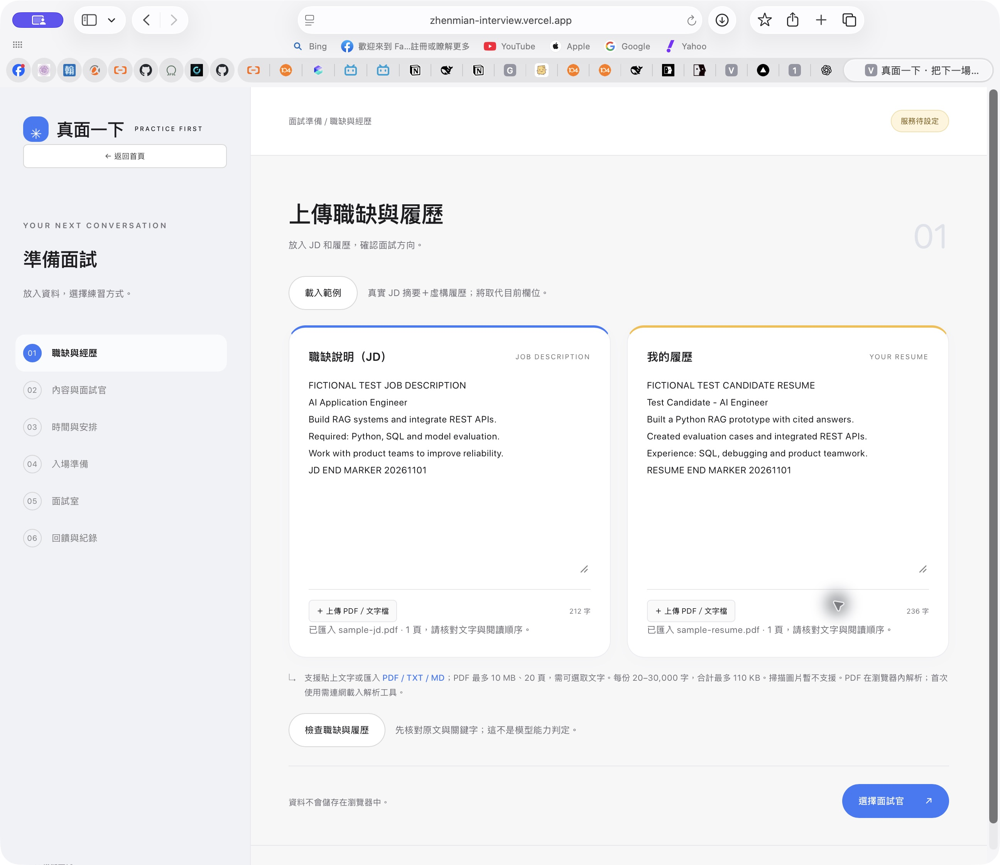

# 真面一下｜AI 模擬面試

把下一場面試，好好聊一次。

YouTube介紹連結：https://youtu.be/UALVc8NLfqI?si=ZFSVBAnkPx0dERv-

上傳 JD 和履歷，選擇面試內容，與 AI 影像面試官對話；結束後回看逐字稿、取得有依據的 AI 建議，並寫下自己的筆記。

**2026-11-03 使用者實測驗收通過**：使用者確認目前版本測試完全 OK，並授權更新 GitHub。本紀錄為使用者體驗驗收，不代表十人評分或延遲量測。

[下載完整專案 ZIP](https://github.com/ccbibo/zhenmian-interview/raw/refs/heads/main/zhenmian-interview-source.zip)

本次更新下載包與原始碼說明；線上部署需另外更新，不能視為已同步上線。

[開啟產品](https://zhenmian-interview.vercel.app/)（目前保留私人部署登入保護；GitHub 原始碼公開不等於公開 API 使用權限。）

## 使用流程

1. 分別上傳 JD、履歷 PDF，或貼入文字。
2. 選擇 HR／技術／綜合面試、輪次與面試官設定。
3. 檢查麥克風；攝像頭可關，沒有攝像頭也能語音面試。
4. 選擇 15–45 分鐘的面試時長（每 5 分鐘調整、預設 30 分鐘），手動開始即時面試；到時結束，不會自動重開。
5. 結束後取得逐字稿；同意後由 AI 整理練習建議。
6. 補充自己的筆記、匯出紀錄，或準備下一輪。

## 產品畫面

以下為自家網站的實測截圖，文件範例為虛構資料；沒有公開使用者真實履歷與對話。





其餘素材與後續展示規劃見 [作品集素材](docs/PORTFOLIO-ASSETS.md)。目前有實測截圖，尚未製作展示影片。

## 技術與資料界線

- Node.js 22+；前端原生 JavaScript／CSS，Node 後端無第三方執行套件。
- Tavus 提供即時人物與語音；DeepSeek 用於文字練習和有據回饋，兩條路徑分開。
- PDF.js 固定版本在瀏覽器解析 PDF，支援 PDF／TXT／MD；不含 Word、OCR 與密碼輸入。匯入後請核對文字順序。
- API 金鑰只保存在伺服器秘密設定；範例設定不含真實值。
- 逐字稿來自實際服務，不把手寫筆記當作語音辨識結果。AI 建議附原回答與文件依據，不生成錄取率或人格判斷。
- 筆記僅留在目前頁面，請匯出保存；目前沒有跨裝置長期同步。

## 在頁面接入自己的 API

本機啟動後，點首頁或面試準備頁右上角的「API 設定」，填入「大模型 API Key」（目前後端連接 DeepSeek）、模型名稱與 Tavus API Key。PAL／Face 由後端檢查與選取，不需要手填。按「儲存並套用」後立即生效，不需要重啟。沒有金鑰也可先啟動介面再設定。

金鑰輸入欄使用密碼格式；儲存後顯示遮罩與已儲存狀態；留空會保留已存金鑰，需要更換時再解鎖輸入。儲存失敗保留輸入，避免重填。設定寫入本機 `.env`（檔案權限 600），不寫入 localStorage、不回傳金鑰、不加入 Git。請自行保管本機檔案，這不是加密金鑰保管庫。面試尚未結束時禁止變更設定。

「檢查已儲存的連線」只向官方 API 讀取 DeepSeek 模型清單與 Tavus PAL 設定，不建立通話、不傳送履歷。通過檢查不代表模型生成、可用餘額或影音品質已完成驗證。Tavus 帳戶需有可使用且包含人物外觀的 PAL；無可用設定時會明確提示。

此設定入口限綁定 `127.0.0.1` 的 Node 本機版。線上部署版本不開放改寫共用伺服器金鑰，仍使用部署平台的私人環境設定。

## 本機執行與測試

```sh
cp .env.example .env
# 在本機私下填入自己的 API 設定
npm run doctor
npm start
```

本機網址為 http://127.0.0.1:4180 。不要將 .env 提交至 Git。

正常使用設定 `TAVUS_MAX_CALL_SECONDS=2700`（未設定時亦預設 2700）。這是最高 45 分鐘的限制，實際通話依使用者選擇。舊環境若仍設為 `120`，須改為 `2700` 並重啟本機服務，或重新部署線上環境，才能解除兩分鐘測試上限。

```sh
npm test
npm --prefix hosted run build
npm --prefix hosted run validate
npm --prefix hosted test
```

部署方式見 [Vercel 設定](deployment/vercel/README.md)、[API 設定](docs/API_SETUP.md)與 [架構](docs/ARCHITECTURE.md)。

## 已知範圍

目前為單人面試版本：一輪一位動態人物，四個角色名稱代表提問設定，尚未各自映射不同人物；第二、三輪支援前輪資料續接。多人同時動態人物、跨節點防重與持久資料儲存仍需擴充。

使用者已確認本次對話流暢度；尚未宣稱量測達成特定 P50／P95、所有瀏覽器與實體攝像頭相容性，或完成十名獨立評審平均 95 分驗收。完整標準見 [驗收規範](docs/ACCEPTANCE.md)。

## 公開內容

完整下載包包含程式、測試、部署文件、公開職缺摘要與虛構測試履歷；儲存庫保留既有產品截圖；不包含金鑰、原始個人履歷、私人面試逐字稿、個人求職介紹稿、匯出筆記、通話權杖、舊 ZIP 或執行紀錄。

## 本次修正

- 面試類型與一至三面分開選擇，移除重複的首頁練習重點區塊。
- API 設定入口、儲存遮罩、連線檢查狀態與錯誤訊息改善。
- Tavus 自動尋找可用 PAL／Face，檢查分頁與逾時、網路錯誤。
- 通話明確指定中文 `languages: ["zh"]`，提示詞要求自然台灣華語、清楚斷句與針對回答追問。中文音色效果仍依供應商和所選聲音而異。
- 本機自動測試 116 項通過；使用者已完成實際體驗確認。
