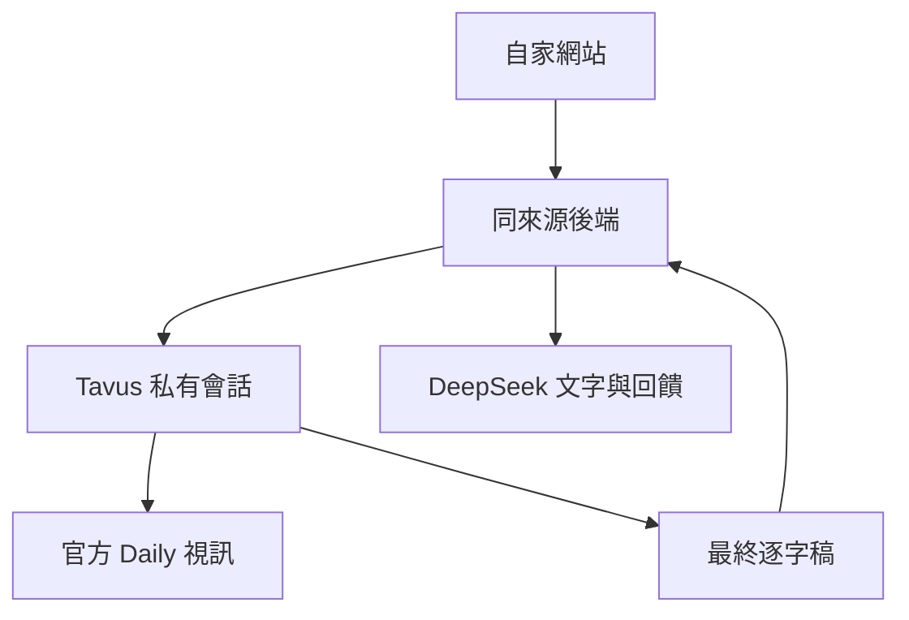

# 真面一下｜單人試驗版架構

## 使用者流程

使用者只在自家網站提供 JD／履歷、選擇單人角色與輪次、檢查麥克風、同意外送並開始面試。攝影機可關閉；人物由 Tavus 提供，並非本機生成。逐字稿與回饋都回到自家網站的紀錄頁。

此圖表示已實作的介面關係，不是線上成功證據。Tavus 即時面試目前使用 PAL 已配置模型；DeepSeek 只接本產品文字練習與回饋，尚未作 PAL 自訂模型。

## 元件與責任

| 元件 | 責任與界線 |
|---|---|
| public/ | 淺色圓潤介面、資料同意、攝影機選用、2分鐘倒數、真實逐字稿與手動筆記分開 |
| lib/interview.mjs | 文件段落證據、模型設定驗證、取消與大小上限、官方逐字稿解析、嚴格回饋格式 |
| server.mjs | 本機單程序會話、owner隔離、原文件與逐字稿記憶體快取、逾時清理 |
| hosted/worker/runtime.mjs | 網站同來源API、加密恢復憑證、原文件雜湊比對、會話與回饋路徑 |
| hosted/source/ | 白名單產品來源快照，讓遠端來源庫可獨立重建，不依賴父資料夾 |
| hosted/scripts/ | 同步來源、compose、build、驗證產物與來源一致 |

## API 契約

| 路徑 | 用途 |
|---|---|
| GET /api/status | 設定完整性、實際時長上限與恢復狀態；不洩露長期金鑰、不把設定當實測 |
| GET /api/trial | 公開JD摘要與明確虛構履歷 |
| POST /api/analyze | 可定位的文字關鍵字對照，非能力評分 |
| POST /api/question | 同意後使用文字模型提出下一題 |
| POST /api/report | 僅文字練習的回饋；與語音會話報告分開 |
| POST /api/session | 明確開始一次Tavus會話，不自動重試 |
| POST /api/session/end | 結束原會話，失敗保留待處理狀態 |
| GET /api/session/:id | 查詢／恢復同owner的原會話，不另建立 |
| GET /api/session/:id/transcript | 已結束會話的官方最終逐字稿，區分ready、pending與empty |
| POST /api/session/:id/report | 明確同意後依原JD／履歷及官方逐字稿生成回饋，忽略client偽造history |

Node保存原文件於程序記憶體；Worker不把文件塞入cookie，而存其SHA256摘要與原設定。Worker回饋需重新提供同份文件並驗證摘要，修改文件則拒絕，以免錯配。回饋只引用實際候選人回合和文件段落，不給錄取率或人格判斷。

## 費用與錯誤界線

單場預設120秒，外部payload也受此上限約束，不只前端倒數。預設不錄影。未知建立結果不得自動重開；既有session恢復不能呼叫create。逐字稿未完成或無候選人回答時不呼叫模型。回饋由使用者點擊產生，非自動背景計費。

正式服務仍缺跨節點持久會話、配額與防重鎖。isolate內鎖及加密cookie只限owner-private單人試驗；清cookie、claim replay與多節點競態不具全域保證。未知建立結果仍可能需要供應商後台確認。此限制阻擋公開多使用者產品，不應把未部署的資料庫設計寫成已完成。

## 驗證與未完成

測試採記憶體HTTP與合成供應商、前端VM／DOMstub；需另外驗證真實HTTPS、自家網站完整問答、實際影音停止、中文追問、打斷和延遲。Tavus後台115秒觀察不取代這些測試。多人動態面試尚未實作；跨三輪資料續接已實作，仍需真實影音與理解品質驗收，PDF／Word解析及100–200筆JD正式語料亦未完成。

完整95分契約保持不變，任何必要項未知即未通過，不按已測部分正規化。

## 三輪資料續接

POST /api/session/:id/continuation 僅對已結束且有最終候選人回答的原會話簽發憑證。憑證存經驗證的lineage引用與逐字稿摘要，不塞入私人逐字稿全文。下一輪POST /api/session只提交continuation.receipt；後端重新讀取各前輪官方逐字稿、核對摘要及原文件，再以不受信任JSON加入面試context。第二輪讀第一輪，第三輪讀第一及第二輪；上限100回合／40KB、期限不延長、不能產生第四輪。這不等同多人同時面試。
